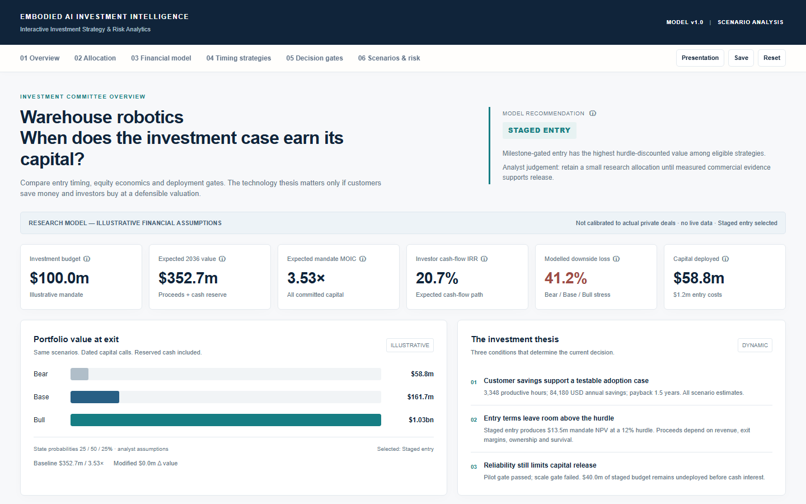

# Embodied AI Investment Intelligence

**Interactive 10-Year Investment Strategy & Risk Analytics Dashboard**

An independent research prototype that turns an embodied AI investment thesis into an explicit capital-allocation and risk decision. It combines scenario-based financial modelling, customer economics and milestone-gated investment timing in a browser-only dashboard.

## Business problem

Technical progress does not establish customer savings or an attractive entry price. This project asks when a robotics investment case earns its capital, how much capital should be exposed before deployment evidence arrives, and which assumptions change the decision.

## Key features

- Compare Invest Now, Wait and Staged Entry against a common 2026–2036 mandate.
- Explore Bear, Base and Bull scenarios, allocation weights and valuation sensitivity.
- Trace investor ownership, follow-on share issuance, dilution and exit equity proceeds.
- Calculate dated cash-flow IRR, mandate IRR, MOIC, hurdle NPV and scenario downside.
- Evaluate customer payback, productive-hour costs and operational deployment gates.
- Explain recommendations through visible financial, safety, rights and evidence checks.
- Inspect parameter provenance and primary research references.
- Save scenarios locally; import/export JSON; export dated cash-flow CSV; print a committee summary; use presentation mode.

## Financial methodology

Revenue projections and EBITDA margins determine terminal enterprise value. Net debt converts enterprise value into equity value. Dated share issuance, ownership, external dilution and assumed commercial survival determine investor proceeds. Unreleased capital remains a separately accounted cash reserve.

Cash-flow IRR uses actual UTC dates and actual days divided by 365. IRR of probability-weighted cash flows is different from averaging scenario IRRs. Mandate IRR charges the full committed budget at the common start date; invested-capital IRR uses actual capital calls. Customer savings are an adoption gate and do not flow directly into investor returns.

The decision engine checks mandatory safeguards, customer economics, pilot/scale evidence, positive hurdle NPV and a user-defined scenario-loss ceiling, then ranks eligible strategies by mandate NPV. It can return Invest Now, Wait, Staged Entry, No-Go or Insufficient Evidence.

## Technology

Vanilla JavaScript, semantic HTML, CSS and native SVG charts. No runtime libraries, paid APIs, backend or live market feed. The published application is a self-contained `index.html`. Its content security policy blocks script changes and outbound application connections. Source links open only when selected; scenarios remain in the visitor's browser.

## Demo and local use

Planned live demo, **publication and anonymous-access verification pending**:

https://zongzaaa.github.io/embodied-ai-investment-intelligence/

To run locally, open `index.html` directly in a modern browser. For a local HTTP preview, run `python -m http.server 8000` in this repository and open `http://localhost:8000`. No installation or account is needed for the application.

## Limitations

Investee proxies, valuations, revenue projections, probabilities, financing terms and default scenarios are illustrative analyst assumptions. Primary sector evidence frames the opportunity; it does not independently calibrate investment returns. Evidence flags are self-reported. No actual fund, investee transaction, audited forecast or commercial financial certification is represented. This prototype is not investment advice. Illiquidity, failed exits and total loss remain possible; tax, carry and interim distributions are outside the model.

No licence has been added; licence selection remains with the project owner.
